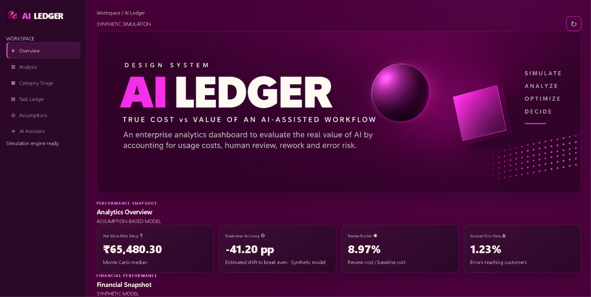

# AI Ledger — AI Workflow Cost & Value Analytics

An enterprise-style analytics project that evaluates the true cost and estimated value of AI-assisted workflows by accounting for AI usage, human review, rework, and escaped-error risk.



## Overview

AI Ledger is a synthetic simulation-based decision-support tool designed to answer a business question:

**Does automating a workflow with AI actually create value after accounting for all associated costs and risks?**

The model evaluates 20,000 simulated task records across five business categories and uses Monte Carlo simulation to estimate possible financial outcomes under configurable assumptions.

## Key Features

- **Analytics Overview:** Financial KPIs, cost composition, and simulation results.
- **Cost & Value Analysis:** AI usage, human review, rework, and escaped-error costs.
- **Category Triage:** Compare category-level performance and automation suitability.
- **Task Ledger:** Inspect task-level cost and value records.
- **Assumptions Management:** Configure hourly labour cost, AI cost, error cost, setup cost, review time, and rework time.
- **Monte Carlo Simulation:** Run 2,000 simulation trials and evaluate P10, P50, P90, mean, and probability of positive value.
- **Sensitivity Analysis:** Examine how changes in accuracy, labour cost, AI cost, and error cost affect estimated value.
- **AI Assistant:** Ask questions about saved model outputs and analysis.

## Technology Stack

| Layer | Technology |
|---|---|
| Frontend | HTML, CSS, JavaScript |
| Backend | Python, Flask |
| Data Processing | Python |
| Analytical Database | DuckDB |
| Data Modelling | SQL |
| Simulation | Monte Carlo |
| Version Control | Git, GitHub |

## Model Workflow

1. Generate 20,000 reproducible synthetic task records.
2. Load task data into DuckDB.
3. Apply configurable business assumptions.
4. Calculate task-level costs and net value using SQL.
5. Generate category-level summaries and cost breakdowns.
6. Run Monte Carlo simulation and sensitivity analysis.
7. Export JSON results for the dashboard.
8. Display updated results after recalculation.

## Business Categories

The model evaluates five categories:

- Billing
- Technical
- Account
- Returns
- Complaints

Each category has different simulated accuracy, review effort, rework effort, error severity, and task volume assumptions.

## Project Structure

```text
AI-LEDGER/
│
├── app.py
├── assumptions.json
├── requirements.txt
│
├── assets/
│   └── ai-ledger-dashboard.png
│
├── data/
│   ├── raw/
│   └── processed/
│
├── scripts/
│   ├── generate_data.py
│   ├── run_analysis.py
│   └── simulation.py
│
├── sql/
│   └── ledger.sql
│
├── exports/
│   └── scenarios/
│
├── index.html
├── analysis.html
├── assumptions.html
└── README.md
```

## Run Locally

**1. Clone the repository**

```bash
git clone https://github.com/saurabhmishra9090/AI-Ledger.git
cd AI-Ledger
```

**2. Create and activate a virtual environment**

```bash
python -m venv .venv
```

Windows:

```bash
.venv\Scripts\activate
```

**3. Install dependencies**

```bash
pip install -r requirements.txt
```

**4. Start the application**

```bash
python app.py
```

**5. Open in your browser**

```text
http://127.0.0.1:5000
```

## Model Assumptions & Limitations

- All 20,000 task records are synthetic, not actual company transactions.
- Financial outputs depend on configurable assumptions.
- Category-level accuracy, error severity, task distribution, review effort, and rework effort are simulated.
- Monte Carlo results represent possible outcomes under the model assumptions, not guaranteed savings.
- The model has not been validated against a live business deployment or measured pilot results.

Actual operational data and a controlled pilot would be required before making financial or automation decisions.

## Project Objective

The objective of AI Ledger is to demonstrate how SQL-based analytics, Python, simulation modelling, and an interactive dashboard can support better AI automation decisions.

**Built as an enterprise analytics portfolio project.**

